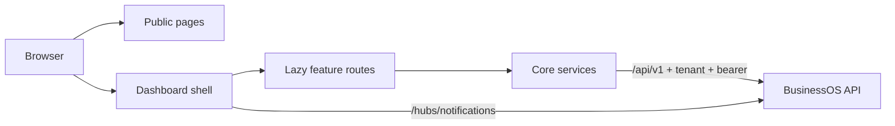

# BusinessOS Web

The Angular app for BusinessOS. One workspace where a business runs stock, sales, customers, money, and the team — and asks **Navla** about that same data.


A sale updates the order, the stock count, and the cash picture together. Each person sees only the modules their role allows. Numbers on the dashboard come from the tenant’s own records, and Navla quotes those records instead of inventing them.

## What is inside

The signed-in app is grouped the same way the sidebar is grouped. Routes are registered in `src/app/app.routes.ts` and labeled in `src/app/shared/constants/nav.constants.ts`.

| Area | What you get | Where it lives |
| --- | --- | --- |
| **Home** | Today’s snapshot: sales, orders, stock pressure, and charts. | `/dashboard` |
| **Buying** | Catalog and prices, stock on hand, suppliers, and purchase orders. | `/products`, `/inventory`, `/suppliers`, `/purchase-orders` |
| **Selling** | Customers, orders, quotes, invoices, and payments received. | `/customers`, `/orders`, `/quotations`, `/invoices`, `/payments` |
| **Insights** | Sales overview, reports, and deeper charts. | `/sales`, `/reports`, `/analytics` |
| **Finance** | Income and spend, expense groups, and profit and loss. | `/finance`, `/expenses`, `/expense-categories` |
| **Administration** | Team, organization, users, roles, permissions, audit, activity, notifications, billing, and settings. | `/team`, `/organization`, `/users`, `/roles`, `/billing`, `/settings`, and related routes |
| **Navla** | A business assistant in a floating chat and a full workspace. It can answer from live tools and, after you confirm, create or change records. | Chat widget on every signed-in page, `/ai/workspace` |

Around that workspace:

- **Public site** — home, about, services, contact, FAQ, privacy policy, terms of service, refund policy, and Insights articles at `/insights`.
- **Account** — email login and registration, Google sign-in, forgot and reset password, and a first-run onboarding flow.
- **Your plan** — subscription, usage, and billing invoices, with plan limits shown in the UI before a limit is hit.

Each business is a tenant. The app sends that tenant on every API call, and a permission guard hides routes the signed-in role cannot open.

## How the frontend is built

Angular 19 standalone components. Features load on demand. Shared chrome (sidebar, navbar, toasts, empty states, charts) is reused so every module feels like one product.



```
src/
├── main.ts                 # Loads public/app-config.json, then boots Angular
├── app/
│   ├── app.routes.ts       # Public pages, auth, and the signed-in shell
│   ├── app.config.ts       # Router, HTTP interceptors, session restore
│   ├── core/               # API services, guards, interceptors, models
│   ├── shared/             # Layouts, design-system components, navigation
│   ├── features/           # One folder per business area, each with its own routes
│   └── state/              # Signal stores for dashboard, inventory, products, Navla
├── environments/           # Defaults; runtime config overwrites the API address
└── styles/                 # Design tokens and global SCSS
```

| Layer | Responsibility |
| --- | --- |
| **Public pages** | Marketing and Insights. No login required. Insights articles are Markdown files under `public/assets/blog/`. |
| **Dashboard shell** | Sidebar, top bar, breadcrumbs, notification bell, theme, and the Navla widget. Opens only after `authGuard`. |
| **Feature routes** | Lazy `*.routes.ts` files. List, create, edit, and detail pages call a domain service in `core/services`. |
| **Core** | `BaseApiService` talks to `/api/v1`. Guards, interceptors, and the in-memory session live here. |
| **State** | Angular signals for screens that share loaded data (dashboard, inventory, products, notifications, Navla). |

## What happens on a page load

1. `public/app-config.json` sets the API address and the public Google client id. Secrets are rejected.
2. The app tries to restore the session with the refresh cookie. The access token stays in memory.
3. `authGuard` sends anonymous visitors to login. `guestGuard` sends signed-in visitors away from login. `onboardingRedirectGuard` continues setup when the workspace is unfinished.
4. `permissionGuard` checks the permission codes on the route (for example `Product.View`, `Invoice.View`). A miss goes to `/forbidden`.
5. The feature service calls the API. The auth interceptor adds `Authorization: Bearer …` and `X-Tenant-ID`. Cookies go with the request. A 401 triggers one silent refresh, then the call is retried.
6. The error interceptor turns API problem details into a toast the user can act on.
7. The notification bell stays live through the SignalR hub at `/hubs/notifications`.

The UI does not choose the tenant. The signed-in user’s tenant id is the only one attached to requests.

## Navla in the UI

Navla is the assistant on top of the same APIs the screens use.

- Suggested questions are loaded for the caller and filtered by the permissions they already have.
- A write (create, update, stock change, payment) shows a confirmation card. Confirm and Cancel send the existing phrase. Drawing the card does not call the create API.
- Voice uses the server speech API. In local development, the browser voice can read a reply if that API is unavailable.
- `/ai/diagnostics` shows recent assistant activity for people who can open the workspace.

The turn-by-turn rules (what counts as an action, how drafts expire, where numbers come from) live in [`docs/SOPHIA_ARCHITECTURE.md`](../docs/SOPHIA_ARCHITECTURE.md). The UI name is Navla.

## Tech stack

- **Angular 19** standalone components, Router, Reactive Forms
- **TypeScript**, **Bootstrap 5**, **Bootstrap Icons**, **SCSS**
- **Angular Signals** and a small amount of **RxJS**
- **HttpClient** interceptors for auth, loading, and errors
- **Chart.js** for dashboard and report charts
- **SignalR** for notifications and activity
- **Marked** and **Prism** for Insights articles and assistant replies
- **Jasmine/Karma** unit tests and **Playwright** end-to-end tests

## Prerequisites

- Node.js 20+
- BusinessOS API listening on `http://localhost:5162`

## Quick start

From this folder (`BusinessOS_UI`):

```bash
npm install
npm start
```

Open [http://localhost:4200](http://localhost:4200).

`proxy.conf.json` forwards `/api` and `/hubs` to `http://localhost:5162`, including WebSockets for notifications. `public/app-config.json` points the app at `/api/v1`, so local calls become `http://localhost:5162/api/v1/...`.

API docs, when the API is running in Development: [http://localhost:5162/scalar](http://localhost:5162/scalar).

## Configuration

| File | Role |
| --- | --- |
| `public/app-config.json` | Live API URL, public Google client id, environment name. Loaded before Angular starts. |
| `src/environments/environment.ts` | Defaults used until the runtime file overwrites `apiUrl`. |
| `proxy.conf.json` | Dev-server proxy to the API. |

`app-config.json` may only contain `apiUrl`, `googleClientId`, and `environmentName`. Put provider keys and database settings on the API, not in this file.

## Scripts

| Command | Description |
| --- | --- |
| `npm start` | Dev server with the API proxy |
| `npm run build:prod` | Production build |
| `npm test` | Unit tests (watch mode) |
| `npm run test:ci` | Headless unit tests with coverage |
| `npm run e2e` | Playwright end-to-end tests |

## Design

- Font: Inter (300–700)
- Primary: `#2563EB`
- Tokens: `src/styles/_variables.scss`
- Theme: light, dark, and appearance settings under `/settings/appearance`, applied with `data-theme`

## Related docs

| Topic | Document |
| --- | --- |
| Backend architecture | [`BusinessOS/docs/Architecture.md`](../BusinessOS/docs/Architecture.md) |
| Navla turn lifecycle | [`docs/SOPHIA_ARCHITECTURE.md`](../docs/SOPHIA_ARCHITECTURE.md) |
| Adding an Insights article | [`docs/insights.md`](docs/insights.md) |

## License

See the repository root `LICENSE.txt`.
